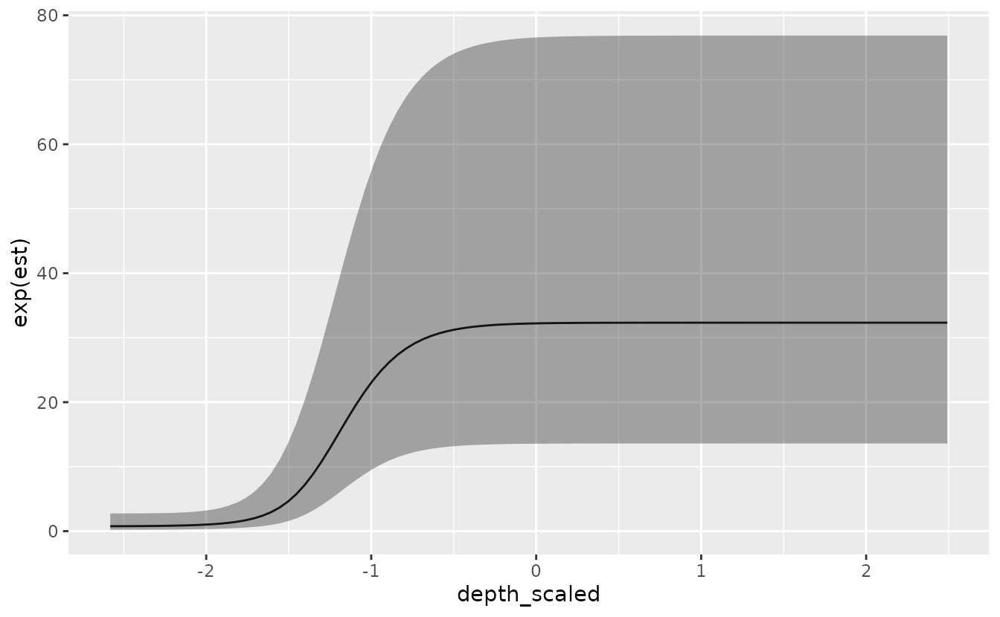
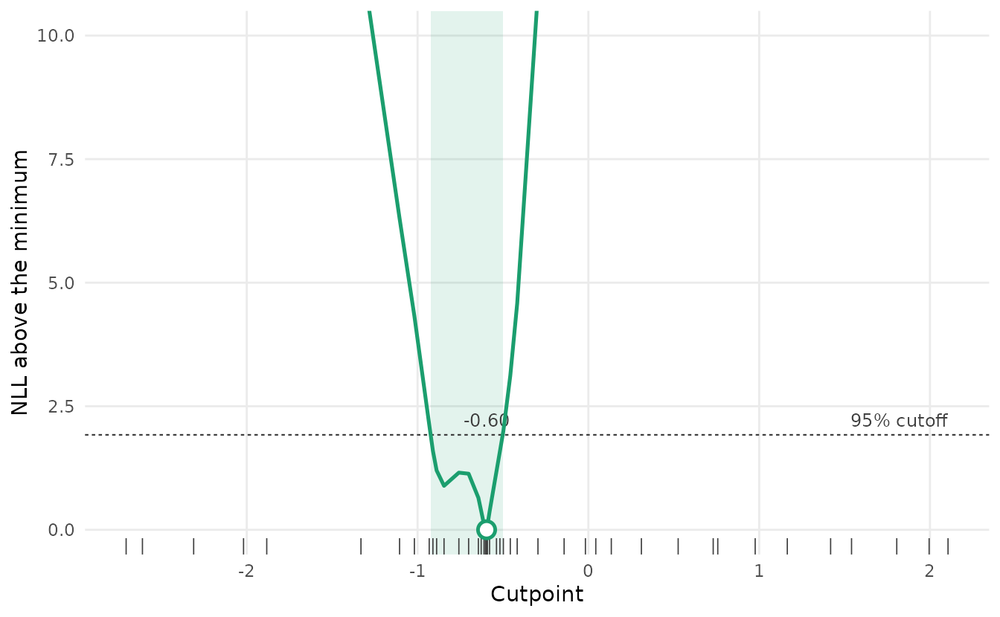
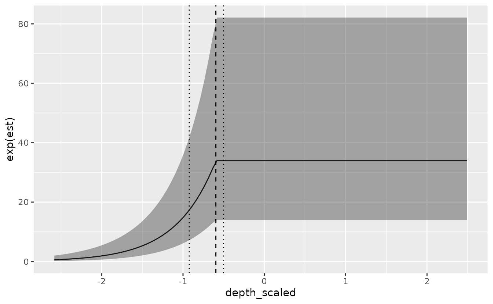
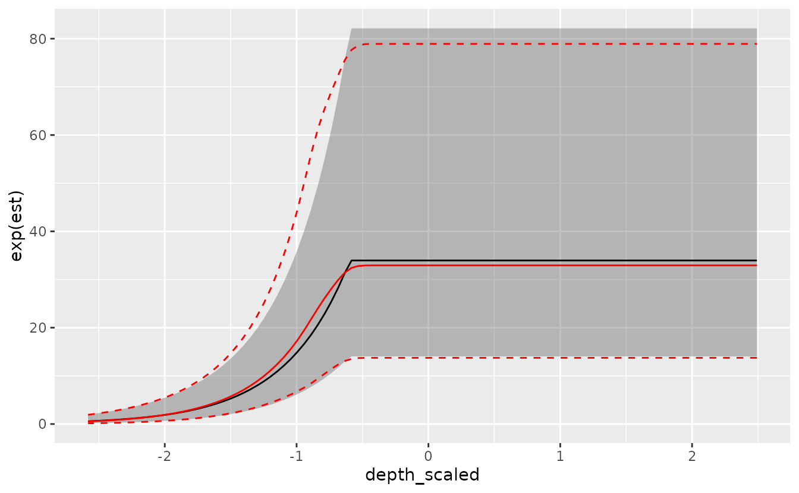
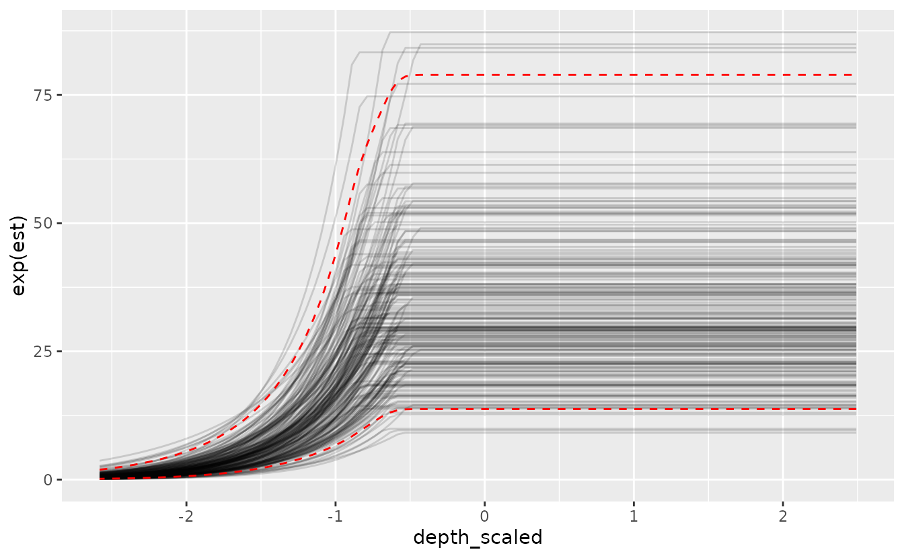

# Threshold modeling with sdmTMB

**If the code in this vignette has not been evaluated, a rendered
version is available on the [documentation
site](https://sdmTMB.github.io/sdmTMB/index.html) under ‘Articles’.**

``` r

library(ggplot2)
library(dplyr)
library(sdmTMB)
```

We’ll repeat the same models used for the index standardization
vignette, using the built-in data for Pacific cod.

As a summary,

- We’ve included columns for depth and depth squared.
- Depth was centred and scaled by its standard deviation and we’ve
  included those in the data frame so that they could be used to
  similarly scale the prediction grid.
- The density units should be kg/km².
- Here, X and Y are coordinates in UTM zone 9.

``` r

glimpse(pcod)
#> Rows: 2,143
#> Columns: 12
#> $ year          <int> 2003, 2003, 2003, 2003, 2003, 2003, 2003, 2003, 2003, 20…
#> $ X             <dbl> 446.4752, 446.4594, 448.5987, 436.9157, 420.6101, 417.71…
#> $ Y             <dbl> 5793.426, 5800.136, 5801.687, 5802.305, 5771.055, 5772.2…
#> $ depth         <dbl> 201, 212, 220, 197, 256, 293, 410, 387, 285, 270, 381, 1…
#> $ density       <dbl> 113.138476, 41.704922, 0.000000, 15.706138, 0.000000, 0.…
#> $ present       <dbl> 1, 1, 0, 1, 0, 0, 0, 0, 0, 1, 0, 0, 0, 0, 0, 0, 0, 0, 0,…
#> $ lat           <dbl> 52.28858, 52.34890, 52.36305, 52.36738, 52.08437, 52.094…
#> $ lon           <dbl> -129.7847, -129.7860, -129.7549, -129.9265, -130.1586, -…
#> $ depth_mean    <dbl> 5.155194, 5.155194, 5.155194, 5.155194, 5.155194, 5.1551…
#> $ depth_sd      <dbl> 0.4448783, 0.4448783, 0.4448783, 0.4448783, 0.4448783, 0…
#> $ depth_scaled  <dbl> 0.3329252, 0.4526914, 0.5359529, 0.2877417, 0.8766077, 1…
#> $ depth_scaled2 <dbl> 0.11083919, 0.20492947, 0.28724555, 0.08279527, 0.768440…
```

We’ll start by developing a mesh. You will likely want to use more
vertices for applied scenarios. You will want to make sure that
increasing the number of vertices does not change the conclusions.

``` r

pcod_spde <- make_mesh(pcod, c("X", "Y"), cutoff = 12)
```

We will extend the simple GLMM used in the index standardization
vignette to include a threshold effect. For real applications, the
threshold effect might be a function of habitat covariates,
environmental variables, etc. Because ‘depth’ is the only external
variable in the `pcod` data frame, we’ll use that. For any threshold
model, you can specify the model as a linear threshold (`breakpt()`) or
logistic (`logistic()`) as part of the formula. To keep this vignette
fast, we turn off the spatiotemporal random fields and include only a
spatial field. Note: as before, if we want to use this model for index
standardization then we need to include `0 + as.factor(year)` or
`-1 + as.factor(year)` so that we have a factor predictor that
represents the mean estimate for each time slice.

This first example uses the ‘depth_scaled’ covariate (depth,
standardized ~ N(0,1)) and the logistic function, similar to selectivity
curves used in fisheries models. The form is

``` math
s(x)=\tau + \psi *\quad { \left[ 1+{ \exp }^{ -ln\left( 19 \right) \quad *\quad \left( x-s50 \right) \quad /\quad \left( s95\quad -\quad s50 \right)  } \right]  }^{ -1 }
```
where $`\psi`$ is a scaling parameter (controlling the height of the
y-axis for the response, and is unconstrained), $`\tau`$ is an
intercept, $`s50`$ is a parameter controlling the point at which the
function reaches 50% of the maximum ($`\psi`$), and $`s95`$ is a
parameter controlling the point at which the function reaches 95%. The
parameter $`s50`$ is unconstrained, and $`s95`$ is constrained to be
larger than $`s50`$.

``` r

m <- sdmTMB(
  data = pcod,
  formula = density ~ 0 + logistic(depth_scaled) + as.factor(year),
  time = "year", mesh = pcod_spde, spatiotemporal = "off",
  family = tweedie(link = "log")
)
```

We can then look at the important coefficients from the model. Here
we’re looking at ‘s50’, ‘s95’, and ‘smax’.

``` r

print(m)
#> Spatial model fit by ML ['sdmTMB']
#> Formula: density ~ 0 + logistic(depth_scaled) + as.factor(year)
#> Mesh: pcod_spde (isotropic covariance)
#> Time column: year
#> Data: pcod
#> Family: tweedie(link = 'log')
#>  
#> Conditional model:
#>                     coef.est coef.se
#> as.factor(year)2003    -0.78    0.67
#> as.factor(year)2004     0.09    0.67
#> as.factor(year)2005    -0.08    0.66
#> as.factor(year)2007    -1.48    0.68
#> as.factor(year)2009    -0.99    0.67
#> as.factor(year)2011    -0.33    0.66
#> as.factor(year)2013    -0.42    0.66
#> as.factor(year)2015    -0.29    0.66
#> as.factor(year)2017    -0.83    0.67
#> depth_scaled-s50       -1.49    0.09
#> depth_scaled-s95       -0.87    0.11
#> depth_scaled-smax       3.76    0.54
#> 
#> Dispersion parameter: 13.83
#> Tweedie p: 1.59
#> Matérn range: 32.11
#> Spatial SD: 2.18
#> ML criterion at convergence: 6526.220
#> 
#> See ?tidy.sdmTMB to extract these values as a data frame.
```

We can visualize the effect:

``` r

nd <- data.frame(
  depth_scaled = seq(min(pcod$depth_scaled) + 0.5,
    max(pcod$depth_scaled) - 0.2, length.out = 100),
  year = 2015L # a chosen year
)
p <- predict(m, newdata = nd, se_fit = TRUE, re_form = NA)
ggplot(p, aes(depth_scaled, exp(est),
  ymin = exp(est - 1.96 * est_se),
  ymax = exp(est + 1.96 * est_se))) +
  geom_line() + geom_ribbon(alpha = 0.4)
```



Next, we can try to fit the same model but use a linear breakpoint /
cutpoint model:

``` r

m <- sdmTMB(
  data = pcod,
  formula = density ~ 0 + breakpt(depth_scaled) + as.factor(year),
  time = "year", mesh = pcod_spde, spatiotemporal = "off",
  family = tweedie(link = "log")
)
#> ℹ The likelihood of a `breakpt()` model isn't smooth in the cutpoint, so the
#>   fit can stop at the wrong cutpoint while reporting convergence, and the
#>   cutpoint's standard error isn't reliable.
#> ℹ Consider `profile_breakpt()` to estimate the cutpoint by profile likelihood.
#> Warning in sqrt(diag(cov)): NaNs produced
#> Warning: The model may not have converged: non-positive-definite Hessian
#> matrix.
```

For this model, the important parameters are the slope,
‘depth_scaled-slope’, and breakpoint, ‘depth_scaled-breakpt’.

``` r

print(m)
#> Spatial model fit by ML ['sdmTMB']
#> Formula: density ~ 0 + breakpt(depth_scaled) + as.factor(year)
#> Mesh: pcod_spde (isotropic covariance)
#> Time column: year
#> Data: pcod
#> Family: tweedie(link = 'log')
#> Warning in sqrt(diag(object$cov.fixed)): NaNs produced
#> Warning in sqrt(diag(object$cov.fixed)): NaNs produced
#> Warning in sqrt(diag(object$cov.fixed)): NaNs produced
#> Warning in sqrt(diag(object$cov.fixed)): NaNs produced
#> Warning in sqrt(diag(object$cov.fixed)): NaNs produced
#> Warning in sqrt(diag(object$cov.fixed)): NaNs produced
#> Warning in sqrt(diag(object$cov.fixed)): NaNs produced
#> Warning in sqrt(diag(object$cov.fixed)): NaNs produced
#> Warning in sqrt(diag(object$cov.fixed)): NaNs produced
#> Warning in sqrt(diag(object$cov.fixed)): NaNs produced
#> Warning in sqrt(diag(object$cov.fixed)): NaNs produced
#> Warning in sqrt(diag(object$cov.fixed)): NaNs produced
#> Warning in sqrt(diag(object$cov.fixed)): NaNs produced
#> Warning in sqrt(diag(object$cov.fixed)): NaNs produced
#> Warning in sqrt(diag(object$cov.fixed)): NaNs produced
#> Warning in sqrt(diag(object$cov.fixed)): NaNs produced
#> Warning in sqrt(diag(object$cov.fixed)): NaNs produced
#> Warning in sqrt(diag(object$cov.fixed)): NaNs produced
#> Warning in sqrt(diag(object$cov.fixed)): NaNs produced
#> Warning in sqrt(diag(object$cov.fixed)): NaNs produced
#> Warning in sqrt(diag(object$cov.fixed)): NaNs produced
#> Warning in sqrt(diag(object$cov.fixed)): NaNs produced
#> Warning in sqrt(diag(object$cov.fixed)): NaNs produced
#> Warning in sqrt(diag(object$cov.fixed)): NaNs produced
#> Warning in sqrt(diag(object$cov.fixed)): NaNs produced
#> Warning in sqrt(diag(object$cov.fixed)): NaNs produced
#> Warning in sqrt(diag(object$cov.fixed)): NaNs produced
#> Warning in sqrt(diag(object$cov.fixed)): NaNs produced
#> Warning in sqrt(diag(object$cov.fixed)): NaNs produced
#> Warning in sqrt(diag(object$cov.fixed)): NaNs produced
#> Warning in sqrt(diag(object$cov.fixed)): NaNs produced
#> Warning in sqrt(diag(object$cov.fixed)): NaNs produced
#>  
#> Conditional model:
#>                      coef.est  coef.se
#> as.factor(year)2003      0.58 14552.97
#> as.factor(year)2004      1.47 14552.97
#> as.factor(year)2005      1.28 14552.97
#> as.factor(year)2007     -0.07 14552.97
#> as.factor(year)2009      0.36 14552.97
#> as.factor(year)2011      1.02 14552.97
#> as.factor(year)2013      0.92 14552.97
#> as.factor(year)2015      1.07 14552.97
#> as.factor(year)2017      0.53 14552.97
#> depth_scaled-slope      -0.65      NaN
#> depth_scaled-breakpt    -3.10      NaN
#> 
#> Dispersion parameter: 14.12
#> Tweedie p: 1.60
#> Matérn range: 26.99
#> Spatial SD: 2.20
#> ML criterion at convergence: 6560.994
#> 
#> See ?tidy.sdmTMB to extract these values as a data frame.
#> 
#> **Possible issues detected! Check output of sanity().**
```

Check this fit with
[`sanity()`](https://sdmTMB.github.io/sdmTMB/reference/sanity.md) and
look at the standard errors before trusting it. The estimated breakpoint
is -3.1, and `depth_scaled` ranges from -3.08 to 2.69. Problems are
common with `breakpt()`. The likelihood isn’t smooth in the breakpoint,
so the optimizer can stop at the wrong breakpoint while reporting
convergence, and the standard error for the breakpoint isn’t reliable
even when the fit looks fine.

Instead, we can estimate the breakpoint by profile likelihood with
[`profile_breakpt()`](https://sdmTMB.github.io/sdmTMB/reference/profile_breakpt.md).
This fits the model with the breakpoint fixed at each of a grid of
values, refines the grid near the best value, and refits the model at
the best breakpoint. It takes the same arguments as
[`sdmTMB()`](https://sdmTMB.github.io/sdmTMB/reference/sdmTMB.md):

``` r

pr <- profile_breakpt(
  data = pcod,
  formula = density ~ 0 + breakpt(depth_scaled) + as.factor(year),
  time = "year", mesh = pcod_spde, spatiotemporal = "off",
  family = tweedie(link = "log")
)
pr
#> Break-point profile: 49 fits (0 failed)
#> Cutpoint -0.596, 95% interval -0.923 to -0.502
#> Slope 2.056, NLL 6526.220, AIC 13082.44 (k = 15, counting the cutpoint)
#> Observations below the cutpoint: 495 (23.1%)
```

The negative log likelihood at the best breakpoint is 34.8 units lower
than the direct fit’s. We can plot the profile. The shaded band is the
95% confidence interval for the breakpoint: every breakpoint whose
negative log likelihood is within the dashed cutoff of the minimum. The
tick marks along the bottom show the breakpoints that were tried.

``` r

plot(pr)
```



The profile isn’t a smooth bowl. It has a small kink wherever the
breakpoint passes an observed depth, and it can have more than one dip.
The data are consistent with any breakpoint in the shaded band. If
`pr$estimate$pieces` is greater than 1 (here it’s 1), the profile rises
above the cutoff inside the band. With kinks and more than one dip, the
gradient doesn’t reliably point an optimizer toward the best breakpoint,
which is why the direct fit can go wrong. The line joins the fits, which
are closest together near the minimum and the ends of the interval, so
it looks more angular where the fits are farther apart.

`pr$fit` is the
[`sdmTMB()`](https://sdmTMB.github.io/sdmTMB/reference/sdmTMB.md) model
with the breakpoint fixed at its best value. For model comparison, use
`AIC(pr)` rather than `AIC(pr$fit)`, because `pr$fit` doesn’t count the
breakpoint as a parameter.

``` r

pr$estimate[, c("cut", "lwr", "upr", "slope")]
#>          cut        lwr        upr   slope
#> 1 -0.5957716 -0.9233306 -0.5015135 2.05639
AIC(pr)
#> [1] 13082.44
pr$fit
#> Spatial model fit by ML ['sdmTMB']
#> Formula: density ~ 0 + breakpt(depth_scaled) + as.factor(year)
#> Mesh: pcod_spde (isotropic covariance)
#> Time column: year
#> Data: pcod
#> Family: tweedie(link = 'log')
#>  
#> Conditional model:
#>                      coef.est coef.se
#> as.factor(year)2003      4.25    0.50
#> as.factor(year)2004      5.12    0.49
#> as.factor(year)2005      4.96    0.49
#> as.factor(year)2007      3.57    0.50
#> as.factor(year)2009      4.04    0.50
#> as.factor(year)2011      4.72    0.49
#> as.factor(year)2013      4.63    0.49
#> as.factor(year)2015      4.75    0.49
#> as.factor(year)2017      4.21    0.50
#> depth_scaled-slope       2.06    0.25
#> depth_scaled-breakpt    -0.60      NA
#> 
#> Dispersion parameter: 13.85
#> Tweedie p: 1.59
#> Matérn range: 32.76
#> Spatial SD: 2.19
#> ML criterion at convergence: 6526.220
#> 
#> See ?tidy.sdmTMB to extract these values as a data frame.
```

We can visualize the linear breakpoint effect from this fit. The ribbon
doesn’t include uncertainty in the breakpoint itself, so we also show
the breakpoint (dashed) and its confidence interval (dotted):

``` r

p <- predict(pr$fit, newdata = nd, se_fit = TRUE, re_form = NA)
ggplot(p, aes(depth_scaled, exp(est),
  ymin = exp(est - 1.96 * est_se),
  ymax = exp(est + 1.96 * est_se))) +
  geom_line() + geom_ribbon(alpha = 0.4) +
  geom_vline(xintercept = pr$estimate$cut, linetype = 2) +
  geom_vline(xintercept = c(pr$estimate$lwr, pr$estimate$upr), linetype = 3)
```



To include uncertainty in the breakpoint, we can refit the model at
several fixed breakpoints across the likely range and average the
predictions. Each fit gets a weight proportional to its likelihood,
which treats the profile as an approximate posterior for the breakpoint
with a flat prior. We use a sequence of evenly spaced breakpoints where
the profile is within 4 units of its minimum. A breakpoint 4 units above
the minimum gets exp(-4), or about 2%, of the weight of the best one, so
breakpoints farther out add little. This is also the range that
[`profile_breakpt()`](https://sdmTMB.github.io/sdmTMB/reference/profile_breakpt.md)
refines (its `within` argument). More breakpoints would be more accurate
but slower.

``` r

near <- pr$profile$cut[pr$profile$dnll < 4]
cuts <- seq(min(near), max(near), length.out = 10)
start <- pr$fit$tmb_obj$env$parList() # start from the best fit; a bit faster
fits <- lapply(cuts, function(cut) {
  start$b_threshold[2] <- cut
  update(pr$fit, control = sdmTMBcontrol(
    start = start,
    map = list(b_threshold = factor(c(1, NA))), # estimate the slope, fix the breakpoint
    multiphase = FALSE
  ))
})
nll <- sapply(fits, function(f) f$model$objective)
w <- exp(min(nll) - nll)
w <- w / sum(w)
round(data.frame(cut = cuts, weight = w), 2)
#>      cut weight
#> 1  -0.93   0.03
#> 2  -0.88   0.10
#> 3  -0.83   0.11
#> 4  -0.77   0.10
#> 5  -0.72   0.09
#> 6  -0.67   0.11
#> 7  -0.62   0.24
#> 8  -0.56   0.15
#> 9  -0.51   0.05
#> 10 -0.46   0.01
```

The ends of this sequence are the outermost profile fits within 4 units,
not where the profile actually crosses 4. Outside that range the profile
fits are farther apart, so an end fit can be well below 4, and
breakpoints just beyond it with some weight are left out. Here the
lowest breakpoint still gets a weight of 0.03. If an end weight isn’t
small, extend that end toward the next profile fit out, for example to
where a straight line between the two fits crosses 4.

Each fit gives a mean and a standard error on the link scale at each
depth. We combine them with the mean and variance of the mixture. The
weighted mean is the estimate. The variance is the weighted average of
the within-fit variances, plus the spread of the means across
breakpoints:

``` r

preds <- lapply(fits, predict, newdata = nd, se_fit = TRUE, re_form = NA)
mu <- sapply(preds, `[[`, "est")
s <- sapply(preds, `[[`, "est_se")
p_mix <- nd
p_mix$est <- drop(mu %*% w)
v_within <- s^2 %*% w # average within-fit variance
v_between <- (mu - p_mix$est)^2 %*% w # spread of the means across breakpoints
p_mix$est_se <- sqrt(drop(v_within + v_between))

ggplot(p_mix, aes(depth_scaled, exp(est),
  ymin = exp(est - 1.96 * est_se),
  ymax = exp(est + 1.96 * est_se))) +
  # breakpoint fixed at its best value:
  geom_ribbon(data = p, alpha = 0.3) +
  geom_line(data = p) +
  # breakpoint uncertainty included:
  geom_ribbon(fill = NA, colour = "red", linetype = 2) +
  geom_line(colour = "red")
```



The red lines include uncertainty in the breakpoint, and the black line
and grey band don’t. Averaging over breakpoints rounds off the kink in
the curve. The band is wider just below the breakpoint, where the fits
disagree most.

Above the breakpoint, the red band is slightly lower and a little
narrower. The profile is skewed, with more of its weight on breakpoints
below the best one. Those fits have a slightly lower plateau and
estimate it more precisely, because more observations fall above their
breakpoint. The breakpoint barely changes the plateau, so averaging over
fits adds almost no spread there. A mixture is always at least as wide
as the average of its fits, but it can be narrower than the single best
fit. The mixture can be skewed, so the mean ± 1.96 SE is only an
approximation.

We can also use simulation draws instead. They’re useful for quantities
that combine predictions, such as a ratio between depths, and they don’t
assume the mixture is normal. We split the draws among the fits in
proportion to their weights:

``` r

sim_mix <- function(newdata, n) { # n[i] draws from fits[[i]]
  do.call(cbind, lapply(which(n > 0), function(i) {
    predict(fits[[i]], newdata = newdata, nsim = n[i], re_form = NA)
  }))
}
```

Each column is one draw of the link-scale predictions at every row of
`newdata`. Here are about 200 draws, each as a grey line, with the red
band from the variance averaging above:

``` r

set.seed(123)
n <- round(200 * w) # about 200 draws in total
draws <- sim_mix(nd, n)
p_draws <- data.frame(
  depth_scaled = nd$depth_scaled,
  est = as.vector(draws),
  draw = rep(seq_len(ncol(draws)), each = nrow(nd))
)
ggplot(p_draws, aes(depth_scaled, exp(est))) +
  geom_line(aes(group = draw), alpha = 0.15) +
  geom_ribbon(
    data = p_mix, fill = NA, colour = "red", linetype = 2,
    aes(ymin = exp(est - 1.96 * est_se), ymax = exp(est + 1.96 * est_se))
  )
```



Each draw has its own kink, at its fit’s breakpoint. The draws mostly
fill the red band, with a few outside it as expected.

For a derived quantity, we draw at just the depths we need. Here’s the
ratio of the density at depth 1 (on the plateau) to the density at depth
-1 (on the slope), with and without uncertainty in the breakpoint:

``` r

nd2 <- data.frame(depth_scaled = c(-1, 1), year = 2015L)
draws <- sim_mix(nd2, round(1000 * w))
ratio <- exp(draws[2, ] - draws[1, ])
quantile(ratio, c(0.025, 0.5, 0.975))
#>     2.5%      50%    97.5% 
#> 1.204281 1.974192 2.802600
draws_best <- predict(pr$fit, newdata = nd2, nsim = 1000, re_form = NA)
quantile(exp(draws_best[2, ] - draws_best[1, ]), c(0.025, 0.5, 0.975))
#>     2.5%      50%    97.5% 
#> 1.867880 2.284366 2.827393
```

The year effect cancels in the ratio, so it depends only on the slope
and on how far the breakpoint is from depth -1. That makes it sensitive
to the breakpoint, and including the breakpoint’s uncertainty widens its
interval a lot, mostly toward smaller ratios. Breakpoints below the best
one are closer to depth -1, which leaves less of a rise between the two
depths.
